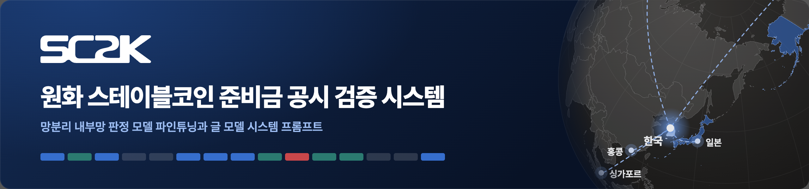
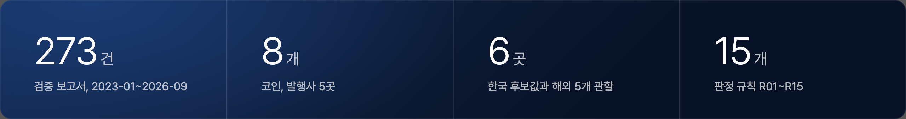
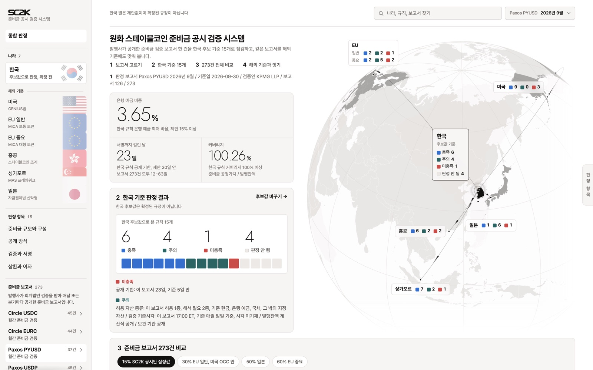
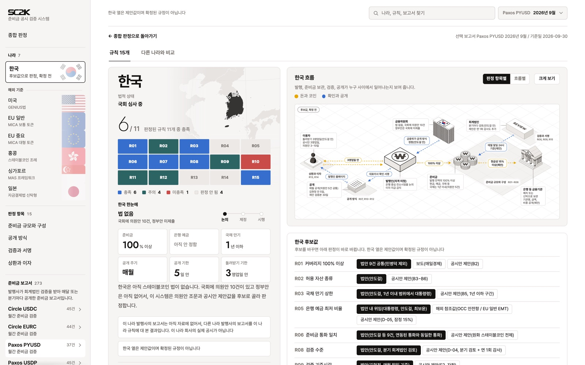
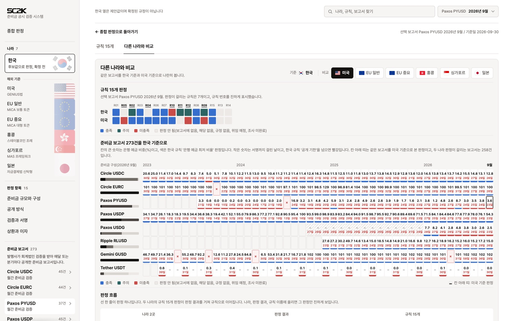

<p align="center"><a href="https://sc2k.kr"></a></p>

<p align="center">
  <a href="https://sc2k.kr"></a>
  
  
  
  
</p>

<p align="center">
  <a href="https://sc2k.kr"></a>&nbsp;
  <a href="#직접-실행"></a>&nbsp;
  <a href="#데이터-출처"></a>
</p>

# SC2K

**원화 스테이블코인 준비금 공시 검증 시스템**

망분리 내부망 판정 모델 파인튜닝과 글 모델 시스템 프롬프트

해외 스테이블코인 발행사가 매달 공개하는 준비금 검증 보고서를 읽어, 미국, EU, 홍콩, 싱가포르, 일본의 공시 기준과 한국 국회 계류 법안의 후보값으로 판정하는 웹 사이트입니다. 한국이 준비금 공시 기준을 정할 때 고를 수 있는 값을 실제 보고서에 넣어 보고, 값을 바꾸면 판정이 어떻게 달라지는지 확인할 수 있습니다.

<p align="center"></p>

[주요 화면](#주요-화면) | [발견](#발견) | [동작 방식](#동작-방식) | [직접 실행](#직접-실행) | [데이터 출처](#데이터-출처) | [현재 제한사항](#현재-제한사항)

> 판정 결과는 공개 보고서에 적힌 내용을 규칙에 넣어 계산한 것이며, 법적 판단이나 투자 권유가 아닙니다. 한국 기준은 확정된 법이 아니라 계류 법안과 SC2K 공시안의 후보값입니다.

## 주요 화면

<p align="center"></p>

<table><tr>
<td width="50%"></td>
<td width="50%"></td>
</tr><tr><td align="center">한국 판정과 후보값</td><td align="center">다른 나라와 비교, 273건 격자</td></tr></table>

| 화면 | 할 수 있는 일 |
| --- | --- |
| **종합 판정** (첫 화면) | 보고서 한 건을 골라 은행 예금 비중, 서명까지 걸린 날, 커버리지를 보고, 한국 후보 기준 15개로 판정한 결과를 본다. 보고서 고르기, 한국 기준 15개, 전체 비교, 해외 기준과 잇기의 네 단계 단추로 화면을 옮긴다 |
| **나라 화면** (`#kr-v1`, `#us` 등) | 보고서 한 건을 규칙 R01~R15 격자로 판정하고, 칸마다 근거 조문과 보고서 원문 줄을 본다. 한국 화면에서는 규칙마다 후보값 칩(법안 값, 공시안 제안값)을 골라 판정을 다시 낸다 |
| **다른 나라와 비교** (`#kr-v1/compare`) | 한국과 다른 관할의 판정을 보고서 전체 격자, 판정 흐름, 숫자 규칙 분포로 나란히 본다 |
| **기준 고르기 표** | 은행 예금 비율 기준 단추(15%, 30%, 50%, 60%)를 바꿔 가며 기준에 못 미치는 보고서 수와 해당 보고서를 띠 표로 본다 |

판정 규칙 15개는 다음과 같습니다.

| 번호 | 규칙 | 번호 | 규칙 | 번호 | 규칙 |
| --- | --- | --- | --- | --- | --- |
| R01 | 커버리지 100% 이상 | R06 | 준비금 통화 일치 | R11 | 발행잔액 계산식 공개 |
| R02 | 허용 자산 종류 | R07 | 공개 주기 | R12 | 보관 기관 공개 |
| R03 | 국채 만기 상한 | R08 | 검증 수준 | R13 | 돌려주는 조건 |
| R04 | 레포 만기 | R09 | 검증 기준시각 | R14 | 이자 지급 금지 |
| R05 | 은행 예금 최저 비율 | R10 | 공개 기한 | R15 | 경영진 서명 |

## 발견

8개 코인(USDC, EURC, PYUSD, USDP, USDG, RLUSD, GUSD, USDT)의 준비금 검증 보고서 273건(2023-01~2026-09)을 판정기 기본값으로 판정한 결과입니다(2026-11-21 기준).

- **커버리지는 모두 충족합니다.** 273건 모두 준비자산이 유통량 이상입니다(R01).
- **공개 기한은 후보값에 따라 크게 갈립니다.** 기본 후보값인 김현정 안의 "다음 달 5일"로 보면 273건 모두 이 기한보다 늦게 서명됐습니다. SC2K 공시안의 "분기 종료 후 30일"로 바꾸면 235건이 기한 안이고 38건이 넘습니다(R10).
- **보관 기관 이름을 적은 보고서는 61건입니다.** 나머지 212건은 준비금을 맡긴 은행이나 수탁기관을 밝히지 않습니다(R12).
- **환매 조건과 이자 지급 여부는 보고서에 없습니다.** 273건 모두 상환 기한, 수수료, 보유자 이자 지급에 관한 문장이 없어, 한국 후보값과 비교할 수 없습니다(R13, R14).
- **미국 최종 규칙의 은행 예금 5% 기준은 57건이 못 미칩니다.** OCC 최종 규칙(91 FR 67000, 2027-01-18 시행)의 요구불예금 5% 이상 기준으로 충족 201건, 미충족 57건, 보고서에 해당 줄이 없는 것이 15건입니다(R05).

## 동작 방식

```text
발행사 공시 PDF ─▶ 파서(글자 층 정규식, 그림 표는 OCR) ─▶ data/reports_*.json
                                                          │
국회 법안 원문, 해외 규정 원문 ─▶ site/jurisdictions/*.json   │
                                     │                    ▼
                                     └─▶ site/engine.js(브라우저에서 판정) ─▶ 화면
```

1. **수집**: 발행사가 공개한 월별 검증 보고서 PDF를 받아 둡니다.
2. **읽기**: 발행사별 파서가 보고서에서 유통량, 준비자산, 자산 줄, 국채 만기, 서명일, 수탁기관 같은 값을 읽습니다. 글자 층이 있으면 `pdftotext -layout`을, 그림으로 된 표는 macOS Vision OCR을 씁니다. 읽은 값마다 원문 쪽과 줄을 함께 남기고, 자산 줄 합계가 총계와 맞지 않는 보고서는 판정에서 빼고 이유를 적습니다.
3. **기준**: 관할마다 규칙 15개의 기준값, 근거 조문, 법적 상태를 `site/jurisdictions/*.json`에 둡니다. 한국은 규칙마다 후보값(법안 값, 공시안 제안값)을 여러 개 둡니다.
4. **판정**: `site/engine.js`가 보고서 값과 기준값을 코드로 비교해 충족, 주의, 미충족, 보고서에 없음 등의 상태를 냅니다. 보고서에 값이 없으면 채워 넣지 않고 "보고서에 없음"으로 둡니다. 판정은 브라우저에서 돌기 때문에 서버가 필요하지 않습니다.

```text
site/            정적 사이트(index.html, app.js, engine.js, jurisdictions/, data/reports.json)
scripts/         발행사별 파서(parse_*.py), 사이트 데이터 합치기(build_site.py), OCR(ocr_vision.swift)
scripts/reading/ LLM과 OCR로 표를 따로 읽어 파서 값과 대조하는 도구
data/            파서 결과(reports_*.json)
graph/           한국 근거 그래프(법령, 법안, 정부 자료와 규칙을 잇는 간선)
tests/           판정 엔진 테스트(node), 파서와 규칙 입력값 테스트(pytest)
```

## 직접 실행

사이트는 빌드 없이 정적 파일로 돕니다.

```bash
python3 -m http.server 8000 -d site
open http://localhost:8000
```

테스트는 다음과 같이 실행합니다. 파서 테스트의 기대값은 PDF 원문을 따로 읽어 확인한 값입니다.

```bash
node --test tests/engine.test.mjs
python3 -m pytest tests
```

보고서 데이터를 다시 만들려면 macOS, Python 3, poppler(`pdftotext`, `pdftoppm`)가 필요하고, `data/samples/`에 보고서 PDF를 받아 두어야 합니다. 파서는 표준 라이브러리만 씁니다.

```bash
python3 scripts/parse_circle.py    # USDC, EURC
python3 scripts/parse_paxos.py     # PYUSD, USDP, USDG
python3 scripts/parse_ripple.py    # RLUSD
python3 scripts/parse_gemini.py    # GUSD
python3 scripts/parse_tether.py    # USDT
python3 scripts/build_site.py      # site/data/reports.json
```

## 데이터 출처

보고서 PDF는 발행사 약관상 재배포 허락이 확인되지 않아 저장소에 넣지 않았습니다. 아래 공개 페이지에서 받을 수 있습니다.

| 발행사 | 코인 | 보고서 | 공개 페이지 |
| --- | --- | --- | --- |
| Circle | USDC, EURC | 월별 examination report | https://www.circle.com/transparency |
| Paxos | PYUSD, USDP, USDG | 월별 examination report | https://www.paxos.com/attestations/ |
| Ripple | RLUSD | 월별 examination report | https://ripple.com/products/stablecoin/transparency/ |
| Gemini | GUSD | 월별 examination report | https://www.gemini.com/dollar |
| Tether | USDT | 분기 assurance report | https://tether.to/transparency/?tab=reports |

기준값의 출처는 관할 파일마다 조문과 주소로 적었습니다. 한국은 국회 의안정보시스템의 의원 발의 법안 10건 원문, 미국은 GENIUS법과 OCC 최종 규칙(Federal Register), EU는 MiCA, 홍콩은 스테이블코인 발행인 규제와 금융관리국(HKMA) 감독지침, 싱가포르는 통화청(MAS) 스테이블코인 프레임워크와 법 개정 자문(P015-2026), 일본은 2023년 개정 자금결제법과 관련 내각부령입니다.

## 현재 제한사항

- **한국 기준**: 정부안이 아직 국회에 제출되지 않아, 한국 기준은 계류 법안과 SC2K 공시안의 후보값입니다. 법이 정해지면 값이 바뀝니다.
- **보고서 범위**: 영문으로 공개된 8개 코인의 월별, 분기 보고서만 읽습니다.
- **판정 범위**: 보고서에 적힌 내용만 판정합니다. 보고서 밖의 약관, 공지, 체인 기록으로 확인할 수 있는 항목도 보고서에 없으면 "보고서에 없음"으로 둡니다.
- **OCR**: 그림으로 된 표는 macOS Vision OCR로 읽으므로, 보고서 데이터를 다시 만드는 일은 macOS에서만 됩니다. 사이트 실행에는 필요하지 않습니다.
